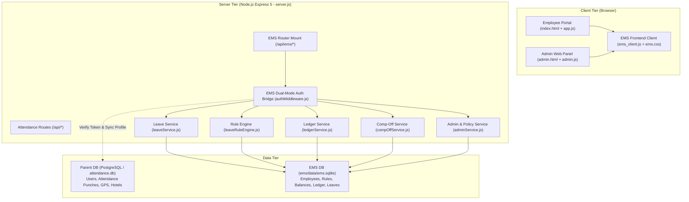
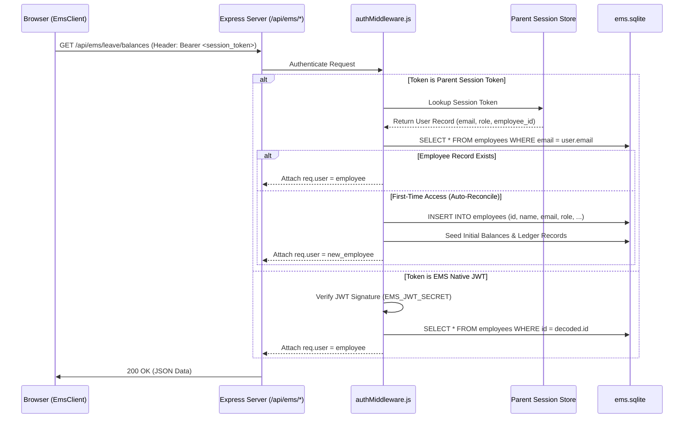

# EMS Integrated Architecture

## 1. Overview and Executive Summary

The Employee Management System (EMS) is seamlessly embedded into the **AIIMS CDER Fieldworker Attendance App** (`attendance-fieldworkers-aiims`). Rather than maintaining two disparate web applications with conflicting authentication engines and fragmented employee profiles, the architecture provides a **unified hybrid system**:

1. **Unified User Surface**:
   - Integrated tab in Employee Portal (`/index.html` -> `#tabNavEms` / `#panelEmployeeManagement`)
   - Integrated tab in Administrator Portal (`/admin.html` -> `#navEmsAdmin` / `#viewEmsAdmin`)
   - Mobile responsive navigation with dedicated bottom nav items (`#bnavEms`).
2. **Dual-Mode Authentication & Session Bridge**:
   - Requests made from the parent attendance app forward the established session token (`Bearer <session_token>`).
   - `authMiddleware.js` verifies the session against the parent session store (and local SQLite fallback `attendance.db`), automatically reconciling or provisioning the employee profile in `ems/data/ems.sqlite`.
   - Native EMS JWT authentication (`Authorization: Bearer <jwt>`) remains intact for backward compatibility and automated CLI testing.
3. **Dedicated Leave Governance & Double-Entry Ledger**:
   - The EMS backend services (`ems/server/services/*`) enforce AIIMS CDER leave rules: `CL` (Casual Leave), `EL` (Earned Leave), `RH` (Restricted Holiday), and `COMP_OFF` (Compensatory Off).
   - All balance changes are immutably audited via double-entry transactions in `leave_transactions`.

---

## 2. System Architecture Diagram

---

## 3. Frontend Architecture & Routing

### 3.1 Single-Page View Switching (SPA)
The parent application uses client-side view switching without full page reloads:

- **Employee Portal**:
  - `switchEmployeeView('ems')` hides `#panelDashboard` and activates `#panelEmployeeManagement`.
  - Sets active state on `#tabNavEms` (desktop tab bar) and `#bnavEms` (mobile bottom navigation).
  - Invokes `window.EmsClient.renderEmployeeEmsPage()` to fetch live balances (`/api/ems/leave/balances`), leave history (`/api/ems/leave/requests`), and comp-off eligibility.
- **Administrator Portal**:
  - `switchView('ems-admin')` hides `#viewOverview`, `#viewEmployees`, etc., and displays `#viewEmsAdmin`.
  - Sets active state on `#navEmsAdmin` in the sidebar and updates the page title to **Employee Management (EMS)**.
  - Invokes `window.EmsClient.loadEmsAdminView()` to populate the pending leave approvals list, review modals, staff leave registers, and credit schedules.

### 3.2 Visual & Design Integration
- All EMS components use `public/ems.css`, adhering to the AIIMS CDER institutional palette:
  - Deep Navy / Slate primary accents (`#1e3a8a`, `#2563eb`).
  - Warm neutral backgrounds (`#f8fafc`, `#ffffff`).
  - Border radii and elevation tokens matching the parent app.
  - 100% SVG iconography, zero emojis or informal characters.
  - Full mobile responsiveness with flexbox wrap and overflow-x handling on tabular data.

---

## 4. Backend Services & Routing

Mounted at `/api/ems` inside `server.js`:

| Route Prefix | Sub-Router | Primary Controller / Service | Description |
| :--- | :--- | :--- | :--- |
| `/api/ems/auth` | `authRoutes.js` | `authController.js` | Direct EMS login, registration, and profile fetching. |
| `/api/ems/leave` | `leaveRoutes.js` | `leaveController.js` | Balance lookup, live deduction calculator, leave application submission, and cancellation. |
| `/api/ems/admin` | `adminRoutes.js` | `adminController.js` | Admin review (APPROVE, REJECT, HOLD), manual ledger adjustments, master data listing. |
| `/api/ems/compoff` | `compOffRoutes.js` | `compOffController.js` | Field worker comp-off duty claims, approval, and balance credit. |
| `/api/ems/calendar`| `calendarRoutes.js`| `calendarController.js` | Gazetted holiday calendar, restricted holidays, and weekly-off retrieval. |

---

## 5. Dual-Mode Authentication Flow

---

## 6. Ledger Accounting Principles

All leave balance modifications in EMS follow strict double-entry ledger bookkeeping:

- Every debit (deduction upon leave application) creates a record in `leave_transactions` with `transaction_type = 'DEBIT'` and the associated `leave_request_id`.
- Every credit (approval of comp-off duty, annual quota credit, or admin adjustment) creates a record with `transaction_type = 'CREDIT'`.
- Cancellation or rejection of previously debited leaves creates a compensating `CREDIT` transaction restoring the balance.
- Total available balance is verified at all times using:
  $$\text{Available Balance} = \sum \text{Credits} - \sum \text{Debits}$$
- This guarantees mathematical immutability and complete auditability for administrative inspections.
