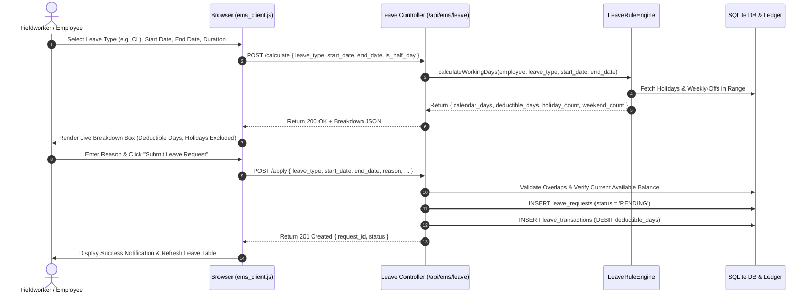
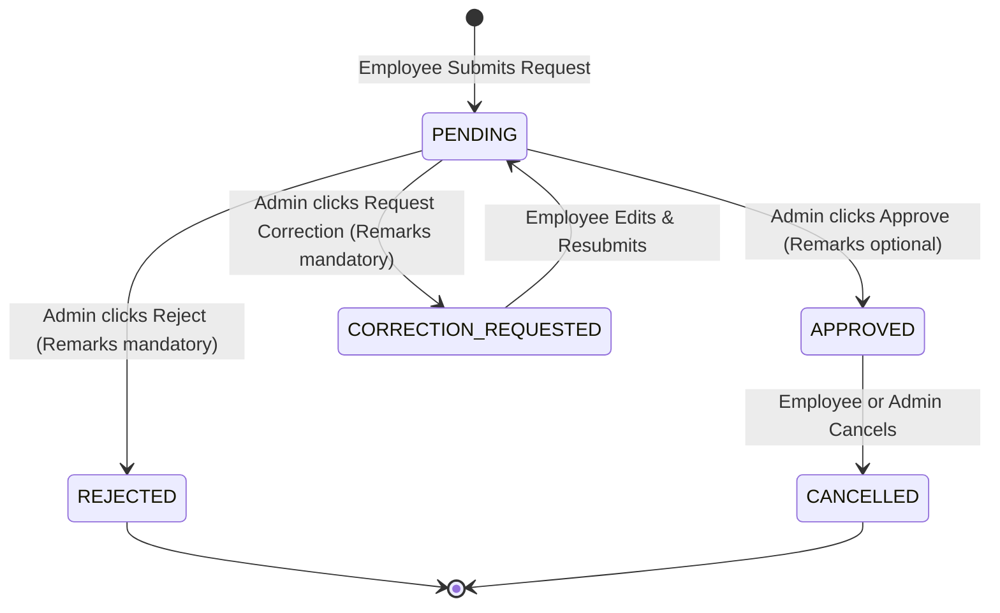

# EMS Features and Workflows

## 1. Overview of Core Features

The integrated Employee Management System provides end-to-end leave lifecycle management tailored to the AIIMS CDER institutional field operations. Key capabilities include:

1. **Self-Service Employee Dashboard**:
   - Live KPI cards displaying remaining leave balances across all recognized leave categories (`CL`, `EL`, `RH`, `COMP_OFF`).
   - Leave history table with real-time status indicators (`PENDING`, `APPROVED`, `REJECTED`, `CANCELLED`, `CORRECTION_REQUESTED`).
   - One-click cancellation for unapproved or draft leave requests.
2. **Interactive Leave Calculation & Application Form**:
   - Dynamic real-time calculation preview (`POST /api/ems/leave/calculate`) triggered on field blur.
   - Breakdown of calendar days vs. deductible working days.
   - Exclusion of gazetted holidays and weekly offs (Sunday for fieldworkers, Saturday/Sunday for office staff).
   - Validation against maximum consecutive days, negative balances, and overlapping requests.
3. **Compensatory Off (Comp-Off) Duty Claims**:
   - Fieldworkers who perform duty on designated holidays or weekly-offs can submit a Comp-Off claim with justification.
   - Upon administrative approval, a compensating credit is posted directly into the employee's `COMP_OFF` ledger.
4. **Administrative Leave Approval Workspace**:
   - Searchable, filterable queue of pending applications.
   - In-depth decision modal displaying employee details, reason, requested dates, and impact on available balances.
   - Support for three authoritative decision states: `APPROVE`, `REJECT`, and `HOLD` (Request Correction).
   - Mandatory decision remarks for rejection and correction requests.
5. **Staff Leave Register & Ledger Audit**:
   - Complete organization-wide leave ledger viewable by authorized administrators.
   - Filterable by employee ID, leave type, date range, and status.

---

## 2. Employee Workflows

### 2.1 Leave Calculation & Application Workflow

### 2.2 Date Calculation Rules & Nuances

| Leave Type | Weekend Exclusion | Gazetted Holiday Exclusion | Half-Day Permitted | Max Consecutive Days |
| :--- | :--- | :--- | :--- | :--- |
| **CL (Casual Leave)** | Yes (Weekly-offs excluded) | Yes (Excludes official holidays) | Yes (0.5 day) | 3 consecutive days |
| **EL (Earned Leave)** | No (Calendar days apply per CCS rules) | No (Sandwich rules apply) | No | 30 days |
| **RH (Restricted Holiday)** | N/A (Single gazetted RH day) | N/A (Must match recognized RH date) | No | 1 day (Max 2 per year) |
| **COMP_OFF** | Yes | Yes | Yes (0.5 day) | 3 consecutive days |

### 2.3 Leave Cancellation Workflow
- If an employee wishes to withdraw an application before or after approval:
  - An employee clicks the **Cancel** button on their dashboard.
  - The client displays an in-app confirmation modal (no native browser `confirm()`).
  - Backend verifies request ownership and checks if dates are in the future.
  - If approved previously, a compensatory `CREDIT` transaction is executed in `leave_transactions` to replenish the employee's balance.
  - Status is updated to `CANCELLED`.

---

## 3. Administrator Approval Workflow

### 3.1 Decision Execution Path

### 3.2 Decision Rules & Protections
1. **Self-Approval Prohibition**: Administrators cannot approve or alter their own leave requests through manipulated API payloads (`employee_id !== reviewer_id`).
2. **Rejection Recredit**: When a leave request is rejected or held for correction, the server immediately voids the provisional debit by crediting back the exact deducted days.
3. **Audit Immutability**: Every decision stores:
   - `reviewed_by`: Administrative user ID.
   - `reviewed_at`: ISO timestamp.
   - `admin_remarks`: Stored review justification shown directly to the employee.
